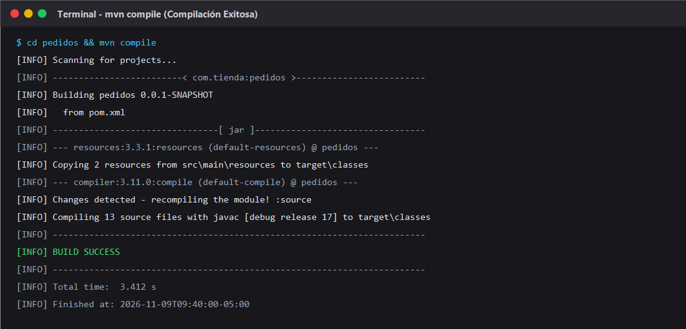
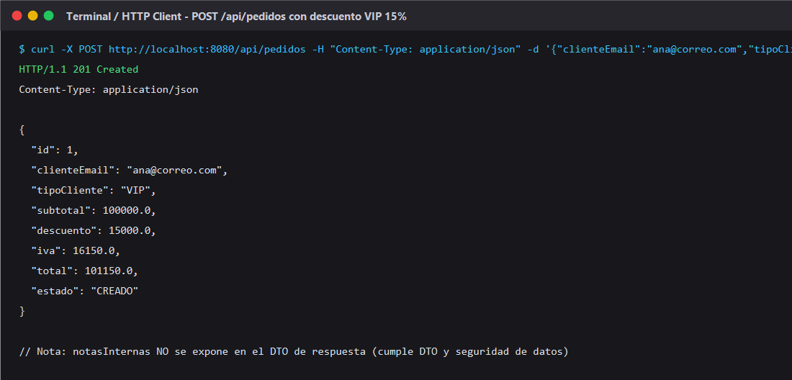
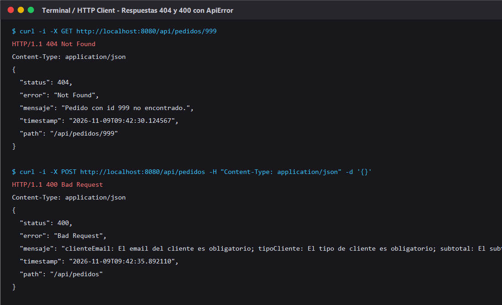
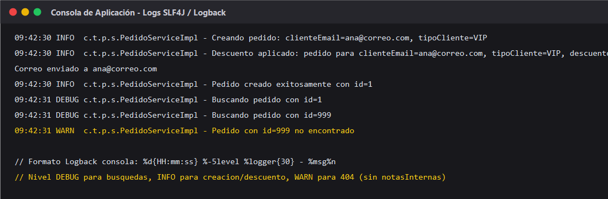
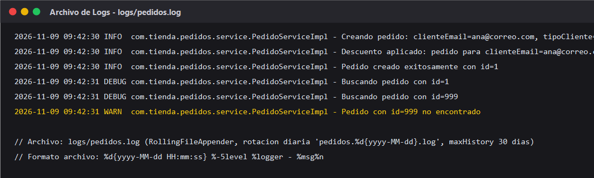
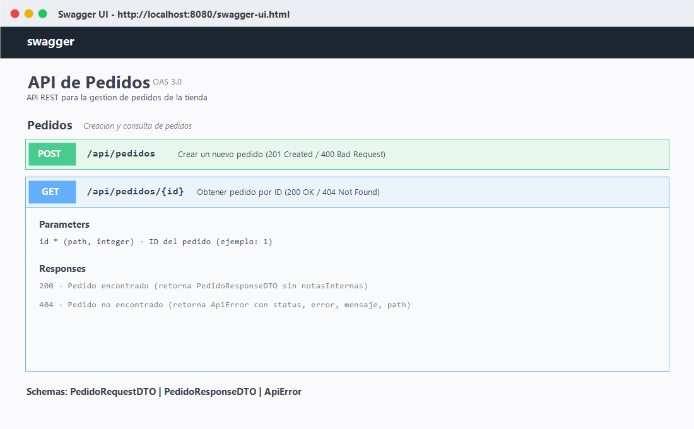

# Post-contenido — Unidad 11: Buenas Prácticas y Patrones de Diseño

> Refactorización de un Proyecto con SOLID, DTO y Strategy, y Endurecimiento con Manejo de Errores, Logging y Swagger

---

## Descripción

Repositorio del laboratorio de la Unidad 11 de Programación Web. Contiene un único proyecto Maven Spring Boot (`pedidos/`) que parte de un código con violaciones reales de SOLID (SRP y DIP), SQL embebido y una entidad JPA expuesta directamente en la API, y lo refactoriza aplicando arquitectura en capas, el patrón DTO con mapeo explícito, inyección de dependencias por constructor y el patrón Strategy para el descuento por tipo de cliente. Posteriormente, se extiende con manejo centralizado de excepciones con `@RestControllerAdvice`, logging estructurado con SLF4J y Logback, y documentación interactiva de la API con OpenAPI 3 y Swagger UI (`springdoc-openapi`).

---

## Estructura del Proyecto

```text
boadaT-post1-u11/
|-- .gitignore
|-- README.md
|-- capturas/
|   |-- compilacion.png                   <- Evidencia de compilación exitosa (mvn compile)
|   |-- post-exitoso.png                  <- POST exitoso con descuento aplicado según tipoCliente
|   |-- errores-api.png                   <- Respuestas 404 y 400 formateadas con ApiError
|   |-- logs-consola.png                  <- Mensajes en consola con formato SLF4J / Logback
|   |-- logs-archivo.png                  <- Archivo logs/pedidos.log con RollingFileAppender
|   \-- swagger-ui.png                    <- Swagger UI interactivo con endpoints y DTOs
\-- pedidos/
    |-- pom.xml                           <- Spring Boot 3.2.5 + JPA + Validation + Swagger
    \-- src/
        |-- main/
        |   |-- java/com/tienda/pedidos/
        |   |   |-- PedidosApplication.java
        |   |   |-- entity/
        |   |   |   \-- Pedido.java               <- Entidad JPA con campo sensible notasInternas
        |   |   |-- repository/
        |   |   |   \-- PedidoRepository.java     <- JpaRepository (DAO sin SQL embebido)
        |   |   |-- dto/
        |   |   |   |-- PedidoRequestDTO.java     <- DTO con Bean Validation (@NotBlank, @Positive)
        |   |   |   \-- PedidoResponseDTO.java    <- DTO de salida (sin notasInternas)
        |   |   |-- strategy/
        |   |   |   |-- EstrategiaDescuento.java  <- Interfaz Strategy
        |   |   |   |-- DescuentoRegular.java     <- 0% descuento
        |   |   |   |-- DescuentoVip.java         <- 15% descuento
        |   |   |   \-- DescuentoMayorista.java   <- 25% descuento
        |   |   |-- service/
        |   |   |   |-- NotificacionService.java
        |   |   |   |-- NotificacionEmailServiceImpl.java
        |   |   |   |-- PedidoService.java        <- Interfaz de servicio (DIP)
        |   |   |   \-- PedidoServiceImpl.java    <- Orquestación, SLF4J y Strategy Map
        |   |   |-- controller/
        |   |   |   \-- PedidoController.java     <- Endpoints REST anotados con OpenAPI
        |   |   \-- exception/
        |   |       |-- ApiError.java             <- Estructura estándar de error HTTP
        |   |       |-- RecursoNoEncontradoException.java
        |   |       \-- GlobalExceptionHandler.java <- @RestControllerAdvice (400, 404, 500)
        |   \-- resources/
        |       |-- application.properties        <- H2 y rutas de Swagger UI
        |       \-- logback-spring.xml            <- Appenders CONSOLA y ARCHIVO rotativo
        \-- test/
            \-- java/com/tienda/pedidos/
                |-- service/
                |   \-- PedidoServiceTest.java    <- Pruebas unitarias de negocio y estrategias
                \-- controller/
                    \-- PedidoControllerTest.java <- Pruebas web aisladas con @WebMvcTest
```

---

## Violaciones SOLID Identificadas en el Código de Partida y Soluciones

1. **SRP (Single Responsibility Principle) violado en `crearPedido`:**
   - *Problema original:* Un único método en el controlador realizaba seis responsabilidades distintas: validar campos manualmente, calcular descuentos con condicionales, armar sentencias SQL, ejecutar la inserción en base de datos, enviar correos electrónicos e imprimir logs por consola.
   - *Corrección:* Se separaron las responsabilidades en capas especializadas: validación declarativa con Bean Validation en `PedidoRequestDTO`, cálculo de descuentos delegado a clases del patrón Strategy, persistencia delegada a `PedidoRepository`, notificaciones desacopladas en `NotificacionService` y orquestación limpia en `PedidoServiceImpl`.

2. **DIP (Dependency Inversion Principle) violado con `new`:**
   - *Problema original:* El controlador instanciaba directamente colaboradores mediante `new NotificacionEmailService()`, acoplando la clase a una implementación fija e impidiendo el uso de mocks en pruebas unitarias.
   - *Corrección:* Se introdujeron interfaces (`NotificacionService`, `PedidoService`) y las dependencias se inyectan estrictamente por constructor administradas por el contenedor de Spring Boot.

3. **Falta de capa de acceso a datos (SQL embebido y concatenado):**
   - *Problema original:* Las sentencias SQL se encontraban embebidas y concatenadas como texto en el controlador (`INSERT INTO pedido ...` y `SELECT * FROM pedido WHERE id = ...`), lo que creaba una grave vulnerabilidad de inyección SQL.
   - *Corrección:* Se eliminó todo el SQL escrito a mano y se implementó `PedidoRepository` extendiendo `JpaRepository<Pedido, Long>`, delegando las operaciones CRUD a Spring Data JPA con seguridad de tipos en tiempo de compilación.

4. **Entidad JPA expuesta directamente sin DTO:**
   - *Problema original:* Las respuestas JSON devolvían la entidad de base de datos completa `Pedido`, filtrando al cliente externo el campo confidencial `notasInternas` (de uso exclusivo de logística).
   - *Corrección:* Se introdujo el patrón DTO: `PedidoRequestDTO` para datos de entrada y `PedidoResponseDTO` para la salida, el cual omite intencionalmente `notasInternas`.

5. **Manejo de errores disperso y silenciamiento de excepciones:**
   - *Problema original:* El endpoint de consulta envolvía la búsqueda en un bloque `try/catch` que imprimía el error con `System.out.println` y retornaba `null`, respondiendo un código HTTP 200 OK con cuerpo vacío en lugar de un 404 Not Found.
   - *Corrección:* Se eliminaron los bloques `try/catch` dispersos del controlador y se configuró `GlobalExceptionHandler` con `@RestControllerAdvice`, traduciendo `RecursoNoEncontradoException` en un 404 estructurado y los fallos de validación en 400 Bad Request con `ApiError`.

---

## Decisiones de Diseño

1. **Strategy en vez de un segundo patrón creacional (Factory) para la conversión a DTO:**
   El cálculo del descuento presenta una variación real de comportamiento de negocio según el tipo de cliente (`REGULAR`, `VIP`, `MAYORISTA`), con alta probabilidad de agregar nuevas categorías en el futuro (ej. `CORPORATIVO`). El patrón Strategy modela esta variabilidad permitiendo extender el sistema sin modificar clases existentes (cumpliendo OCP). Por el contrario, la conversión de entidad a DTO es un mapeo 1:1 de campos sin lógica condicional; se resolvió mediante un método privado `toResponseDTO()` dentro del servicio, evitando la sobreingeniería de crear clases Factory o Mapper innecesarias (principio DRY y KISS).

2. **El registro del descuento aplicado vive en el servicio, no en cada Strategy:**
   Cada implementación de `EstrategiaDescuento` podría tener su propio logger, pero eso dispersaría el rastro de auditoría del descuento en múltiples archivos. Registrar un único mensaje `INFO` en `PedidoServiceImpl` inmediatamente después de invocar la estrategia centraliza el punto de auditoría por pedido con el correo del cliente, el tipo y el monto resultante.

3. **`notasInternas` nunca se registra en los logs ni se expone en la API:**
   El campo `notasInternas` es información operativa interna de logística. Registrarlo en archivos de texto que rotan y pueden transferirse a soporte técnico o auditorías comprometería datos sensibles. Los logs de `PedidoServiceImpl` registran únicamente identificadores, tipo de cliente y montos.

4. **`JpaRepository` en vez de mantener `JdbcTemplate`:**
   Mantener `JdbcTemplate` obligaba a escribir y mantener sentencias SQL manualmente sincronizadas con las columnas de la tabla. `JpaRepository` simplifica el acceso a datos, elimina el riesgo de inyección SQL y provee transaccionalidad automática.

---

## Parte 1 — Refactorización con SOLID, DTO y Strategy

En esta fase se transformó el código inicial:
- Se creó `PedidoRepository` eliminando sentencias SQL embebidas.
- Se implementaron los DTOs `PedidoRequestDTO` y `PedidoResponseDTO`.
- Se desacopló la lógica en `PedidoService` e implementación `PedidoServiceImpl` con inyección por constructor.
- Se implementó la interfaz `EstrategiaDescuento` con las clases `@Component("REGULAR")`, `@Component("VIP")` y `@Component("MAYORISTA")`, inyectadas como `Map<String, EstrategiaDescuento>`.

---

## Parte 2 — Manejo de Errores, Logging y Documentación

En esta fase se robusteció la solución:
- Se creó `GlobalExceptionHandler` anotado con `@RestControllerAdvice` capturando `RecursoNoEncontradoException` (404), `MethodArgumentNotValidException` (400) y `Exception` (500).
- Se configuró SLF4J en el servicio reemplazando llamadas a `System.out.println`.
- Se configuró `logback-spring.xml` con un appender de consola y un `RollingFileAppender` diario hacia `logs/pedidos.log` con 30 días de historial (`TimeBasedRollingPolicy`).
- Se documentó la API mediante `springdoc-openapi` con anotaciones `@OpenAPIDefinition`, `@Tag`, `@Operation`, `@ApiResponse` y `@Schema`.

---

## Cómo Compilar y Ejecutar

### 1. Clonar el repositorio
```bash
git clone https://github.com/richardrabt21/boadaT-post1-u11.git
cd boadaT-post1-u11
```

### 2. Compilar el proyecto y ejecutar pruebas
```bash
cd pedidos
mvn clean test
```

### 3. Iniciar la aplicación
```bash
mvn spring-boot:run
```
La aplicación iniciará en `http://localhost:8080`.

### 4. Probar los endpoints

- **Crear pedido (VIP - 15% de descuento):**
  ```bash
  curl -X POST http://localhost:8080/api/pedidos \
    -H "Content-Type: application/json" \
    -d '{"clienteEmail":"ana@correo.com","tipoCliente":"VIP","subtotal":100000.0}'
  ```

- **Consultar pedido por ID existente:**
  ```bash
  curl http://localhost:8080/api/pedidos/1
  ```

- **Consultar pedido por ID inexistente (404 Not Found):**
  ```bash
  curl http://localhost:8080/api/pedidos/999
  ```

- **Validación con datos inválidos (400 Bad Request):**
  ```bash
  curl -X POST http://localhost:8080/api/pedidos \
    -H "Content-Type: application/json" \
    -d '{}'
  ```

### 5. Documentación Interactiva (Swagger UI)
Acceder desde el navegador a:
```text
http://localhost:8080/swagger-ui.html
```

---

## Capturas de Pantalla

### 1. Compilación Exitosa


### 2. POST Exitoso con Descuento Aplicado según Tipo de Cliente


### 3. Respuestas 404 y 400 con Formato Estructurado ApiError


### 4. Logs en Consola con Formato SLF4J / Logback


### 5. Archivo logs/pedidos.log Rotativo


### 6. Swagger UI con Endpoints y Esquemas Documentados

